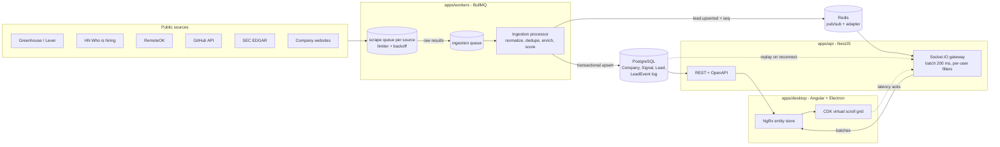

# SalesIntel — realtime sales intelligence platform

Angular 21 + Electron desktop client, a NestJS API with a Socket.IO gateway, BullMQ workers that
scrape **public** sources for **companies with buying signals** (hiring, filings, open source
activity), PostgreSQL for persistence and Redis for queues and fan-out.

> **Status: phases 1-6 implemented; phase 5 measurements have not been run yet.** Six sources are scraped (Greenhouse, Lever, RemoteOK, GitHub, SEC EDGAR,
> website enrichment), scored, persisted, exposed over authenticated REST and pushed to the desktop client
> over Socket.IO. Metrics, a load test runner, a grid benchmark, an offline cache and ADRs exist; the load test
> and grid benchmark have not been run, so there are no latency or FPS figures yet. See
> [`docs/benchmarks.md`](docs/benchmarks.md), [`docs/TODO.md`](docs/TODO.md) and the [roadmap](#roadmap).

Repository: <https://github.com/rllapur89/sales-intelligence-scraping>

## Design goals

- Scrapers never block the delivery path; they never write to the DB or talk to clients.
- One slow source never blocks the others: one queue per source, each with its own limiter and backoff.
- Updates are batched (~200 ms) and filtered per user before they leave the server.
- The client stays smooth with tens of thousands of rows (virtual scroll, batched entity upserts).
- Leads are companies. No personal data (names, personal emails, phones) is collected or stored.

## Architecture



Sequence numbers come from the append-only `LeadEvent` table. A client that reconnects sends its last
seen `seq`; the server replays the missing deltas from Postgres or tells it to do a full resync.

## Repository layout

| Path              | Package          | Purpose                                                                            |
| ----------------- | ---------------- | ---------------------------------------------------------------------------------- |
| `apps/desktop`    | `@leads/desktop` | Angular + Electron client (moved from the repo root, unchanged)                    |
| `apps/api`        | `@leads/api`     | NestJS REST + Socket.IO gateway, OpenAPI at `/docs`                                |
| `apps/workers`    | `@leads/workers` | NestJS standalone app hosting BullMQ processors                                    |
| `packages/shared` | `@leads/shared`  | Types, DTO interfaces, queue names, socket event contracts (no runtime deps)       |
| `packages/db`     | `@leads/db`      | Prisma schema, migrations, seed, client. Shared by api and workers (not a 4th app) |
| `infra/`          | —                | Prometheus and Grafana provisioning                                                |
| `tools/loadtest`  | —                | Artillery load test (phase 5)                                                      |

## Run it

Requirements: Node >= 20.11, npm 11, Docker.

```bash
cp .env.example .env     # set SEC_EDGAR_USER_AGENT / GITHUB_TOKEN later, when those sources land
npm install
npm run dev              # builds libs, starts Docker infra, applies migrations, runs api + workers + desktop
```

`npm run dev` runs, in order: `build:libs`, `docker compose up -d --wait` (Postgres, Redis, Prometheus,
Grafana), `prisma migrate deploy`, then api, workers and the Angular dev server together.
Seed demo users and sources once with `npm run db:seed`.

| Service     | URL                                         |
| ----------- | ------------------------------------------- |
| Desktop dev | <http://localhost:4200>                     |
| API / docs  | <http://localhost:3000/api/health>, `/docs` |
| Prometheus  | <http://localhost:9090>                     |
| Grafana     | <http://localhost:3001> (admin / admin)     |

Other scripts: `npm run lint`, `typecheck`, `test`, `build`, `format:check`. Desktop only:
`npm run electron:dev -w @leads/desktop`.

## Trying the pipeline (phase 2)

```bash
npm run db:seed                      # sources + demo users (once)
curl -X POST localhost:3000/api/jobs -H 'content-type: application/json' \n  -d '{"source":"greenhouse","slugs":["figma","stripe"]}'   # omit slugs to scrape all configured companies
curl localhost:3000/api/jobs                                   # job status, progress, errors
curl 'localhost:3000/api/leads?minScore=30&limit=20'           # keyset-paginated leads
curl localhost:3000/api/metrics/summary
```

All REST routes except `/api/health`, login, refresh and `/docs` require a JWT. Log in as a seeded demo user
(`sales@demo.local` / `demo1234`, or `admin@demo.local`; set `DEMO_USER_PASSWORD`) with `POST /api/auth/login`
and send `Authorization: Bearer <accessToken>`. Swagger lives at `/docs`. Companies to scrape
are in `apps/workers/config/companies.json` (30 Greenhouse boards, 28 Lever sites; edit freely).

How a job flows: `POST /api/jobs` creates a `ScrapingJob` and enqueues one `plan` job in `scrape-<source>`.
The worker fans it out into one queue job per company, so the per-source limiter (2 req/s, a
self-imposed courtesy value) bounds HTTP requests. Retryable failures (429, 5xx, network) back off
exponentially with jitter and honour `Retry-After`, which also pauses that source's queue. Scrapers
hand raw results to the `ingestion` queue; ingestion normalizes, dedupes by domain, scores and upserts in
one transaction per company, appends a `LeadEvent` (the sequence number) and publishes `lead.upserted` on Redis.

## Realtime delivery (phase 3)

- **Gateway:** Socket.IO on the API port, authenticated with the same access JWT (`auth: { token }`; a bad token fails with `unauthorized`). `@socket.io/redis-adapter` lets several API instances run.
- **Batching and filters:** every API instance listens to the Redis `leads:events` channel, buffers `GATEWAY_BATCH_WINDOW_MS` (200 ms), coalesces per lead id and sends each user only leads matching their active subscriptions (industry, region, signal type, minimum score). A user with no active subscription receives nothing; the seed creates an "All leads" one per demo user.
- **Backpressure:** a socket whose outbound buffer is not drained keeps one pending entry per lead id (newest wins) instead of queueing batches.
- **Resync:** the client sends `leads:resync { lastSeq }` on connect. The server replays missed deltas from the `LeadEvent` table (with a 100-event overlap, because autoincrement ids can become visible out of commit order and the client ignores older versions) or answers `full` (`unknown-seq`, `gap-too-large`) so the client reloads a REST snapshot.
- **Latency acks:** the client samples rendered batches and sends `latency:ack`; the API records them in the `leads_pipeline_latency_seconds` histogram (see [`docs/metrics.md`](docs/metrics.md)).

### Desktop modes

```bash
npm run start -w @leads/desktop        # mock mode (default): no backend needed
npm run start:live -w @leads/desktop   # live mode: REST + Socket.IO against localhost:3000
```

The client now uses the company model (no person fields, no LinkedIn/Crunchbase/Twitter sources). The header badge shows Live / Reconnecting / Offline / Mock.

## Data sources and terms

Implemented, each reviewed in [`docs/sources.md`](docs/sources.md) (endpoints, auth, limits, attribution, what we store and avoid):

| Source             | Signal                                      | Needs                                                                                                                             |
| ------------------ | ------------------------------------------- | --------------------------------------------------------------------------------------------------------------------------------- |
| Greenhouse, Lever  | `hiring`                                    | nothing                                                                                                                           |
| RemoteOK           | `hiring`                                    | nothing. **Jobs link back to Remote OK** (their API terms); few jobs expose a company domain, so yield is low                     |
| GitHub REST        | `oss-activity` (new repos, releases)        | `GITHUB_TOKEN`; skipped without it                                                                                                |
| SEC EDGAR          | `filing` (issuer forms only)                | `SEC_EDGAR_USER_AGENT` with your contact; skipped without it                                                                      |
| Website enrichment | `website-tech` + description and tech hints | nothing. Honors robots.txt (RFC 9309). `WEBSITE_FETCHER=http` (default) or `playwright` (needs `npx playwright install chromium`) |

Skipped on purpose: Hacker News "Who is hiring" (owner's decision, terms unclear). A source whose terms
forbid this use is skipped. LinkedIn, Apollo and ZoomInfo are never scraped.

### Lead score (0-100)

One component per signal type plus a diversity bonus, deterministic given the clock (`apps/workers/src/ingestion/score.ts`):
hiring `15·log2(1 + Σ recency weight)`, filing 25 (30 days) or 10 (90 days), oss-activity up to 15
(new repo 8, release 5), funding up to 20, website-tech 5, +10 per extra live signal type. Recency weight:
1 up to 14 days, 0.5 up to 30, 0.2 up to 90, then 0.

## Analytics, CRM and alerts

- **Analytics and reports:** funnel, leads by source and industry, signal mix and score trend, served by
  `GET /api/analytics/*` and shown as SVG charts with CSV and JSON export (see [`docs/analytics.md`](docs/analytics.md)).
- **CRM:** notes, tasks, an activity timeline and lead assignment, in the lead detail panel, the dashboard
  and the Kanban (see [`docs/crm.md`](docs/crm.md)).
- **Alerts:** a lead that stops matching a subscription is retracted from the clients that hold it, and
  subscriptions with `notify` create notifications shown in a bell in the header (see
  [`docs/alerts.md`](docs/alerts.md) and [ADR 0005](docs/adr/0005-lead-retraction.md)).

None of these was run against a live database yet: they are covered by unit and component tests, and the
two migrations (`crm`, `notifications`) were written by hand and only validated with `prisma validate`.

## Measurements

Not available yet: the tools exist but have not been run (no Docker or Chromium was available when they
were written). [`docs/benchmarks.md`](docs/benchmarks.md) explains how to produce the numbers. When it is
filled in, every figure will come from **local runs of this project** (`tools/loadtest` with 1,000
Socket.IO clients and a synthetic ~500 events/s publisher; `tools/grid-benchmark` with 50,000 rows), not
from production traffic.

## Quality

ESLint (flat config) + Prettier across the monorepo, strict TypeScript, Vitest everywhere. CI is
defined in `.github/workflows/ci.yml` (install, lint, format check, typecheck, test, build).

## Known limitations (through phase 2)

- `apps/desktop` is excluded from Prettier and its lint rules are warnings (pre-existing unused
  imports and `any`), so the move stays a pure relocation.
- Integration tests (`apps/workers/src/integration`, `apps/api/src/integration`) need the compose Postgres/Redis and a dedicated schema; they are not part of CI yet.
- The API and the workers each map DB rows to `LeadDto` (duplicated mappers); still to consolidate.
- A lead whose score drops below a subscription's minimum is not retracted from clients that already hold it.
- The live desktop client has been verified with unit tests and a Node socket client, not yet in a browser or Electron window.
- On a memory-starved Windows host set `NODE_OPTIONS=--max-semi-space-size=1` if Node dies with out-of-memory errors at boot.
- Job postings that disappear from a board are not retired yet; scoring decays by signal age instead.
- Electron packaging inside the workspace (`electron-builder` with hoisted `node_modules`) is not yet re-verified.

## Roadmap

1. **Foundation** (this phase): monorepo, shared types, skeletons, Prisma schema, compose, CI.
2. First real source end to end: Greenhouse + Lever, per-source queues, ingestion, REST, job tracking (this phase).
3. Realtime: Socket.IO gateway, JWT auth, Redis adapter, batching, filters, resync; desktop on live data, mock mode kept (this phase).
4. Remaining sources, scoring, subscriptions UI, backpressure (done; subscriptions UI and backpressure landed in phase 3).
5. Measurement: Prometheus metrics, Grafana dashboard, load test runner, grid benchmark (implemented; **runs pending**, see `docs/benchmarks.md`).
6. Hardening: offline snapshot cache, ADRs, worker presence check, shared mapper, CI integration job (done); Electron heap snapshots and packaging re-check still **TODO**, see `docs/TODO.md`.

## Original desktop demo

The mock-data demo (1,200 generated leads, simulated scraping, NgRx entity store, CDK virtual scroll,
Electron tray and memory monitor) lives in `apps/desktop` and remains the default until phase 3.
